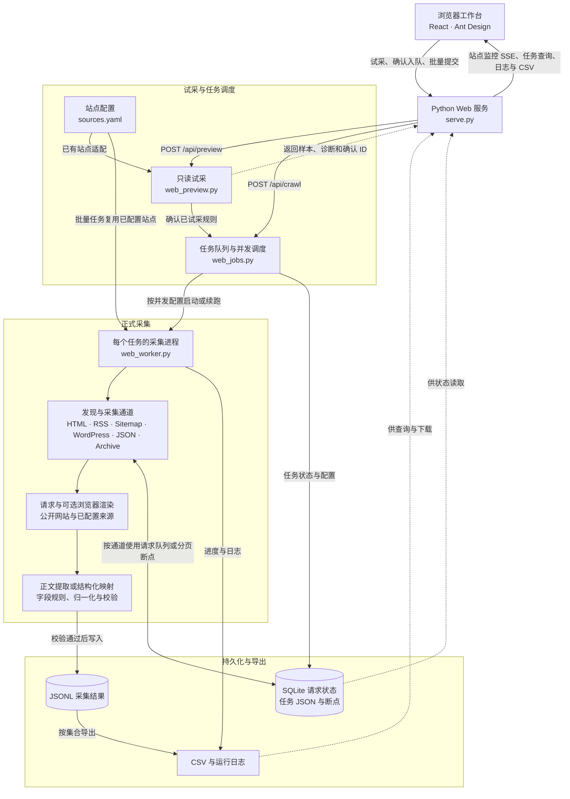

# MultiTypes-CrawlSpider

MultiTypes-CrawlSpider 是一套自托管网页采集服务。用浏览器试采公开站点或栏目，确认正文、链接和采集范围后再提交任务。服务器负责排队、断点续采和 CSV 导出，工作台展示进度、诊断和覆盖率核对结果。

从 main 克隆或使用 GitHub Release 安装，初始站点清单均为空。首次打开「采集工作台」，在「试采预览」填入自己的第一个网址，核对样本后确认入队。


[工作台](#工作台与功能组件) · [快速开始](#快速开始) · [采集通道](#采集通道) · [架构](#项目架构) · [技术栈](#技术栈) · [配置与维护](#配置与维护)

## 工作台与功能组件


截图来自本地演示采集任务。

| 界面 | 可以做什么 |
| --- | --- |
| **采集总览** | 查看已登记文章 URL 数、监控站点数量、当前采集速率和队列并发。 |
| **采集工作台** | 自动识别或手动选择通道，设置栏目或路径范围，查看正文样本和失败诊断。可以调整 HTML 字段 XPath 再复测，也可以按行批量提交网址。 |
| **网页采集任务** | 查看进度、集合结果与日志，停止、继续或转入长期采集，并按集合下载 CSV。 |
| **站点监控** | 查看进度与覆盖率，批量刷新核对或补采，查看近 7 天的详情通过率和主要失败原因。 |


## 快速开始

| 使用场景 | 入口 |
| --- | --- |
| Apple Silicon Mac 本机使用（macOS 15+） | 下载 [macOS arm64 DMG](https://github.com/chatgarypt-cpu/MultiTypes-CrawlSpider/releases/tag/macos-v0.1.0)，拖入「应用程序」后打开，工作台会在默认浏览器启动。首次打开提示见发布说明。 |
| 本地运行、开发适配器或维护站点配置 | `main`，包含采集器前后端、测试和开发记录 |
| CentOS Linux 8.4 x86_64 服务器部署 | [服务器发布包](https://github.com/chatgarypt-cpu/MultiTypes-CrawlSpider/releases/tag/server-v0.4.0)，包含独立源码和 Podman 安装脚本 |

### 本地运行

准备 Python 3.12+、uv 和 Node.js 22.12+，在项目根目录执行：

```bash
./deploy/start-web
```

启动脚本会在缺少项目虚拟环境时按锁文件安装 Python 依赖，构建 React + Ant Design 前端，然后启动服务。浏览器打开 <http://127.0.0.1:8787/>。运行目录、环境变量和端口配置见[网页服务指南](deploy/README.md)。

### CentOS 8 服务器部署

下载服务器包、核对校验值并解压：

```bash
release=https://github.com/chatgarypt-cpu/MultiTypes-CrawlSpider/releases/download/server-v0.4.0
curl -fLO "$release/MultiTypes-CrawlSpider-server-v0.4.0.tar.gz"
curl -fLO "$release/SHA256SUMS"
sha256sum -c SHA256SUMS
tar -xzf MultiTypes-CrawlSpider-server-v0.4.0.tar.gz
cd MultiTypes-CrawlSpider-server-v0.4.0
sudo bash deploy/centos8/install.sh
curl -fsS http://127.0.0.1:8787/healthz
```

部署脚本使用 Podman 构建和运行镜像，由 systemd 管理服务。Python、前端构建环境和浏览器依赖在镜像内。初始账号为 `admin`，密码保存在服务器的 `/etc/rea-crawler/web.env`。[CentOS 安装、升级和备份说明](deploy/centos8/README.md)

## 在工作台采集

1. **输入网址并试采**。可提交域名、栏目页或文章页。支持自动识别，也可手动选择网页列表、RSS / Atom、站点地图、WordPress REST、JSON 接口、JSON 列表或网页存档。
2. **核对样本和范围**。可按默认范围、通道可发现的全部内容、当前栏目或 URL 路径采集。WordPress REST 支持选择文章、页面、媒体元数据和站点公开的自定义类型。HTML 类通道可调整标题、发布日期和正文的 XPath 后复测。
3. **确认入队**。正式任务沿用已试采的通道、范围和规则。已知站点可切换到「批量入队」，每行填一个网址。
4. **查看进度与导出**。可查看日志和集合结果，停止或继续任务，按内容类型下载 CSV。网页任务可加入订阅，已启用的长期采集网址会显示在订阅列表。

试采只返回样本，正式任务按配置处理发现的内容。媒体集合提供元数据和链接。任务「本轮完成」表示已处理本轮发现的范围，历史覆盖率须依据公开 API 总量、站点地图等独立清单核对。


## 采集通道

| 通道 | 面向的来源 |
| --- | --- |
| `wp-api` | WordPress 公开 REST 集合，支持文章、页面、媒体元数据和其他公开内容类型。 |
| `html` | 网页列表及详情链接，可配置 XPath、链接模式和列表分页。 |
| `rss` | RSS、Atom 和 RDF 订阅源。订阅窗口由来源提供。 |
| `sitemap` | 站点地图及子地图，支持 URL 筛选。 |
| `json-api`、`json-list` | 通过站点配置接入公开 JSON 接口，按分页读取条目或发现详情页。 |
| `archive` | 通过 Wayback CDX 发现公开存档和历史快照，属于开发分支的配置型通道。 |

浏览器中的试采使用 HTTP 直连，支持 HTML、RSS、站点地图及 WordPress REST。其他通道或渲染方式由站点适配器配置，运行前需准备相应依赖。

## 项目架构



试采复用站点发现和字段提取能力，只返回样本。正式任务为每个网站任务启动独立进程，将队列、结果和断点保存在该任务的数据目录中。已有站点的命令行采集也复用同一套采集通道和提取逻辑。[模块与数据流说明](collector/ARCHITECTURE.md)

## 技术栈

| 层 | 技术 | 对应功能 |
| --- | --- | --- |
| 工作台 | **React 19、TypeScript 5.9、Ant Design 6、Vite 8** | 试采表单、样本折叠面板、步骤条、任务表格和前端构建。 |
| Web 服务 | **Python 3.12+、`http.server`、SSE** | 静态资源、JSON API、CSV 下载和实时站点监控。 |
| 抓取和渲染 | **requests、curl_cffi、Playwright Chromium、Camoufox** | HTTP 请求、配置型连接方式和动态页面渲染。浏览器能力依运行环境安装。 |
| 解析和内容提取 | **Trafilatura、lxml / XPath、PyYAML、pypdf** | 正文提取、字段选择、站点配置解析，以及启用后的 PDF 文本提取。 |
| 队列和数据 | **SQLite、JSON、JSONL、CSV** | 持久化请求状态、任务与断点，保存条目和导出结果。 |
| 构建和测试 | **uv、npm、pytest** | 锁定依赖、构建前端和运行回归测试。 |
| 部署 | **Docker Compose、Podman、systemd** | 容器化运行。CentOS 8 发布分支用 Podman 构建镜像，由 systemd 管理服务。 |

## 配置与维护

| 内容 | 位置 |
| --- | --- |
| 实际站点的入口、分页、链接筛选和字段规则 | 本机的 `collector/sources.yaml`，可从[空白模板](collector/sources.example.yaml)复制后编辑。Git 默认忽略本机清单。 |
| CLI 命令、采集通道及断点管理 | [采集器说明](collector/README.md) |
| 队列、抓取和提取流程 | [采集器架构](collector/ARCHITECTURE.md) |
| 本地和 Docker Compose 运行 | [部署说明](deploy/README.md) |

需要为命令行或后台轮询配置站点时，首次运行 `cp -n collector/sources.example.yaml collector/sources.yaml`，在本机清单中添加自己的站点，再执行 `uv run python collector/collect.py --validate`。直接在网页试采和入队无需创建清单。

默认数据目录为 `collector/data`，网页任务存放在其 `web-jobs/` 子目录。迁移或备份时应保留完整数据目录，才能继续使用队列和断点。

```bash
uv sync --frozen
uv run --frozen pytest
npm --prefix collector/ui ci
npm --prefix collector/ui run build
```
