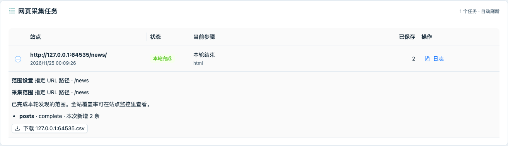
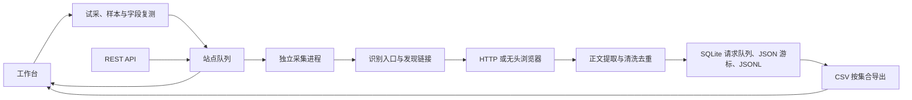

# MultiTypes-CrawlSpider

[](https://github.com/chatgarypt-cpu/MultiTypes-CrawlSpider/releases/tag/server-v0.2.2)


MultiTypes-CrawlSpider 是一套自托管网页采集服务。通过工作台试采公开站点、核对正文样本并设定范围后提交任务。服务器负责排队、断点续采和 CSV 导出。

[工作台](#工作台与功能组件) · [快速开始](#快速开始) · [站点类型](#站点类型与适配) · [并发说明](#并发与任务队列) · [架构](#设计与技术栈) · [API](#api-示例)

## 工作台与功能组件


截图来自本地演示采集任务。

| 界面 | 可以做什么 |
| --- | --- |
| **采集总览** | 查看已入库文章、监控站点数量、当前采集速率和队列并发。 |
| **采集工作台** | 自动识别或手动选择通道，设置栏目或路径范围，查看正文样本和失败诊断。可以调整 HTML 字段 XPath 再复测，也可以按行批量提交网址。 |
| **网页采集任务** | 查看当前步骤、已保存数量、集合结果与日志。可停止或继续任务，并按集合下载 CSV。 |
| **站点监控** | 查看原有站点任务的进度与覆盖率核对状态，筛选正在运行或已结束的站点。 |



## 快速开始

### CentOS 8.4 x86_64 服务器

下载服务器源码包和校验文件，解压后执行安装脚本。脚本在服务器上用 Podman 构建容器镜像，由 systemd 管理启动和重启。首次构建需要访问依赖与浏览器下载地址。

```bash
release=https://github.com/chatgarypt-cpu/MultiTypes-CrawlSpider/releases/download/server-v0.2.2
curl -fLO "$release/MultiTypes-CrawlSpider-server-v0.2.2.tar.gz"
curl -fLO "$release/SHA256SUMS"
sha256sum -c SHA256SUMS
tar -xzf MultiTypes-CrawlSpider-server-v0.2.2.tar.gz
cd MultiTypes-CrawlSpider-server-v0.2.2
sudo bash deploy/centos8/install.sh
```

服务默认绑定服务器本机的 `127.0.0.1:8787`。在服务器上检查 `curl -fsS http://127.0.0.1:8787/healthz`。从操作电脑访问时，可以先建立 SSH 转发：

```bash
ssh -N -L 8787:127.0.0.1:8787 user@server
```

在浏览器打开 <http://127.0.0.1:8787/>。账号为 `admin`，初始密码在服务器的 `/etc/rea-crawler/web.env`。端口配置、日志、升级和备份见 [CentOS 运维手册](deploy/centos8/README.md)。

### 本地试用

准备 Python 3.12+、[uv](https://docs.astral.sh/uv/getting-started/installation/) 和 Node.js 22.12+。在源码根目录运行：

```bash
bash deploy/start-web
```

启动脚本按锁文件安装前后端依赖，构建网页，再启动本地服务。默认地址为 <http://127.0.0.1:8787/>，本地可先直接试用 HTTP 采集。服务器镜像自带两种无头浏览器。使用 Docker Compose 的部署方式见 [网页服务指南](deploy/README.md)。

## 在网页上使用

1. 在采集工作台输入站点、栏目或文章 URL，自动识别入口或手动选择通道。
2. 按需限定起始路径，或为 WordPress 选择文章、页面、媒体元数据及其他公开集合。
3. 试采并检查样本和诊断。调整 XPath 字段后点「复测字段」，确认样本后加入队列。
4. 在任务列表查看进度、集合结果和日志，按需停止或继续。完成后按集合下载 CSV。

## 站点类型与适配

| 站点或入口 | 识别与配置 | 适用场景 |
| --- | --- | --- |
| 提供公开 REST API 的 WordPress | 自动探测 `/wp-json/` 和 `rest_route`，查看公开集合和分页 | 博客、文档站、媒体站的文章和页面归档 |
| 发布站点地图的网站 | 自动寻找 Sitemap，遍历子图中的链接。也可配置路径和 URL 过滤 | 按栏目收集内容或从索引回填历史页面 |
| 提供 RSS / Atom 的网站 | 自动探测订阅入口。网页自动任务也可遍历同域链接。固定订阅源可配置为 `rss` | 从近期更新开始采集，或定向抓取一份订阅源 |
| 静态 HTML 和列表页 | 通用任务遍历同域公开链接。专用适配可配置列表入口、链接模式或 XPath | 公告、文档、内容目录和详情页采集 |
| JSON 接口和 JSON 列表 | 在站点配置中选择 `json-api` 或 `json-list`，按接口分页，或从列表定位详情页 | 有稳定公开接口的内容库和公告列表 |
| 需要 JavaScript 渲染的页面 | 为站点配置 `via: playwright` 或 `via: camoufox` | 需要页面渲染后才能读取的公开正文或列表 |

自动识别适合有标准公开入口的站点。特定列表、接口或动态页面可以在 [`collector/sources.yaml`](collector/sources.yaml) 配置适配。公开范围由目标网站的入口和访问条件决定。任务的「本轮完成」表示处理完本轮发现的范围。历史覆盖率可用站点地图、公开 API 总量等独立清单核对。媒体集合导出元数据及地址。

下面以站点地图为例。将示例域名、入口和目录规则替换成自己的目标：

```yaml
- domain: example.org
  base: https://example.org
  channel: sitemap
  sitemap: /sitemap.xml
  url_filter: /articles/
  via: direct
```

在本地源码目录校验配置，也可先查看发现结果和少量正文样本：

```bash
uv run python collector/collect.py --validate
uv run python collector/collect.py --check-site example.org
uv run python collector/collect.py --check-extract example.org --samples 3
```

## 并发与任务队列

| 设置 | 默认值和行为 |
| --- | --- |
| 同时运行的网站任务 | **4 个**。在网页的并发设置中修改，或调用 `POST /api/concurrency`。接受正整数，配置会持久化。 |
| 超出并发的任务 | 按提交时间排队。同一个域名已有运行中或排队任务时，重复提交会提示并合并。 |
| 普通适配器的站内并发 | `SITE_WORKERS` 默认 **4**，用于普通页面抓取。WordPress 分页以及浏览器通道由各适配器控制。 |
| 单次提交大小 | HTTP 请求体上限为 **1 MiB**。大清单可分次提交，共用同一任务队列。 |

并发设置控制调度槽位。实际吞吐受主机资源、页面体积、浏览器开销和目标站限速影响。服务适合单主机运行，每个数据目录由一个服务实例管理。

## 设计与技术栈



| 层 | 技术 | 职责 |
| --- | --- | --- |
| 网页界面 | React 19、Ant Design 6、TypeScript 5.9、Vite 8 | 试采、任务控制、日志和结果下载 |
| Web 服务 | Python 3.12+、标准库 HTTP 服务、REST、SSE | 处理任务接口、推送状态和提供管理界面 |
| 抓取与提取 | Requests、curl_cffi、Playwright、Camoufox、Trafilatura 和 lxml | 公开 HTTP 请求、TLS 指纹、页面渲染、正文和元数据提取 |
| 状态与结果 | SQLite、JSON、JSONL、CSV | 持久化请求状态、任务快照、断点和导出结果 |
| 构建与运维 | uv、npm、Podman、systemd、Docker Compose | 依赖锁定、容器构建、安装升级和进程管理 |

- **入口与抓取方式分开配置。** 同一发现策略可以使用 HTTP 或浏览器，页面提取与导出走同一套字段和校验。
- **按站点隔离进程和数据。** 任务的状态、日志、请求队列和导出文件分别保存，重启后仍可查看。
- **支持断点继续。** 用规范化后的 URL 记录请求身份和已处理进度。失败或跳过的条目进入状态统计，可结合日志复查。
- **控制对目标站的请求。** 通用抓取复用连接并按域限速，对可重试的 HTTP 错误做有限重试。服务器默认通过本机端口访问。

## API 示例

以下以通过 SSH 转发访问已部署的服务为例。curl 会提示输入 `admin` 的密码。

```bash
curl --user admin -fsS http://127.0.0.1:8787/api/crawl \
  -H 'Content-Type: application/json' \
  -d '{"urls":["https://example.com/","https://example.org/"]}'

curl --user admin -fsS http://127.0.0.1:8787/api/jobs
```

`POST /api/crawl` 返回每个地址的入队结果和任务 ID。任务列表包含状态、日志地址和 CSV 下载地址。使用 `POST /api/jobs/<任务ID>/stop` 停止，使用 `POST /api/jobs/<任务ID>/resume` 继续，JSON 请求体传 `{}`。

## 源码与测试

- [`collector/crawler/`](collector/crawler/) 包含站点通道、提取清洗、请求队列和存储。
- [`collector/ui/`](collector/ui/) 是 Web 界面。
- [`collector/tests/`](https://github.com/chatgarypt-cpu/MultiTypes-CrawlSpider/tree/main/collector/tests) 是使用临时目录和本地站点夹具的测试。
- [`deploy/`](deploy/) 包含镜像、安装脚本和运维说明。

在 GitHub 仓库的源码检出目录构建前端后，运行 `uv run --frozen pytest`，检查入口识别、配置校验、续采、错误处理和 CSV 下载。
